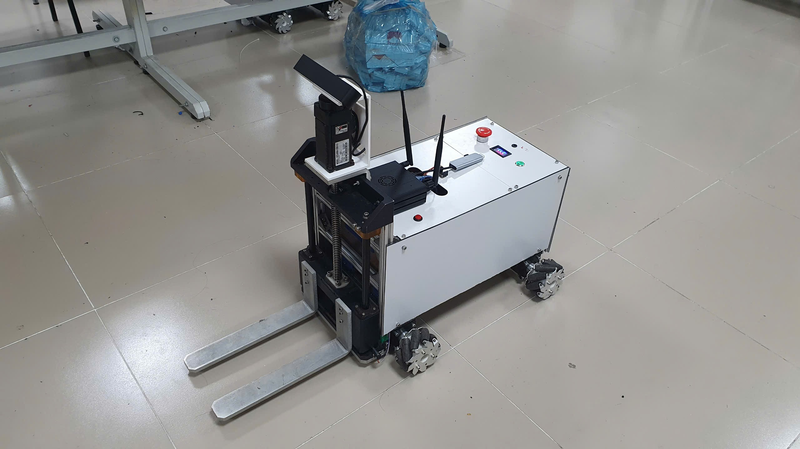

# Forklift AMR — Autonomous Mecanum Forklift Navigation Stack (ROS2 Humble)

[](https://docs.ros.org/en/humble/)
[](https://www.nvidia.com/en-us/autonomous-machines/embedded-systems/jetson-orin/nano-super-developer-kit/)
[](https://www.stereolabs.com/products/zed-2)
[](LICENSE)

An industrial-oriented **Autonomous Mobile Robot (AMR) Forklift** powered by **ROS2 Humble**, **Nav2**, **3D ZED2 Perception**, and **ESP32 Micro-ROS**. Engineered for tight-space warehouse pallet handling using omnidirectional Mecanum kinematics, 3D Spatio-Temporal Voxel obstacle avoidance, and hardware-tuned trajectory smoothing.



---

## Key Engineering Highlights

* **Omnidirectional Mecanum Kinematics & Payload Stability:** Structural chassis validated up to **$19.34\text{ kg}$** static load. Lateral velocity ($V_y = 0.20\text{ m/s}$) and acceleration limits are carefully constrained to prevent wheel slip and protect heavy pallet loads.
* **3D Multi-Sensor Costmap Fusion:** Combines 2D LiDAR (`/scan`) with ZED2 RGB-D point clouds (`/zed2/zed_node/point_cloud/cloud_registered`) via `SpatioTemporalVoxelLayer` (STVL) to detect elevated forks and overhanging obstacles[cite: 1].
* **Industrial-Grade Navigation Tuning:** Uses `SmacPlannerHybrid` (`REEDS_SHEPP` motion model) for reverse pallet docking[cite: 1], paired with a $30\text{ Hz}$ `DWBLocalPlanner` and `velocity_smoother`[cite: 1].
* **Deterministic Low-Level Control:** Multi-threaded ESP32 running Micro-ROS over UART ($921600\text{ baud}$), integrating an Extended Kalman Filter (EKF) for Wheel Odometry + IMU fusion and a digital Low-Pass Filter ($\alpha = 0.1$) for jerk-free motor actuation.
* **Data-Driven Validation:** Benchmarked across $10$ consecutive physical runs per scenario, achieving **$80\%$ convergence** on $5\text{m}$ straight paths (within $5\text{ cm}$ goal tolerance) and **$100\%$ repeatability** on S-curve trajectories[cite: 1].

---

## System Architecture

```text
+-----------------------------------------------------------------------+
|                     NVIDIA JETSON ORIN NANO                           |
|  +-----------------------+     +-----------------------------------+  |
|  |   Sensors & Fusion    |     |        ROS2 Humble / Nav2         |  |
|  | - 2D LiDAR (/scan)    |---->| - SLAM Toolbox / AMCL Localization|  |
|  | - ZED2 RGB-D Camera   |     | - STVL 3D + 2D Costmap Fusion     |  |
|  | - EKF (Odom + IMU)    |     | - SmacPlannerHybrid + DWB (30Hz)  |  |
|  +-----------------------+     +-----------------+-----------------+  |
+------------^-------------------------------------|--------------------+
             | Raw Odom & IMU                      | /cmd_vel (Smoothed)
             | (Micro-ROS)                         | UART @ 921600 baud
+------------+-------------------------------------v--------------------+
|                      ESP32 (Micro-ROS Firmware)                       |
|  +-----------------------+     +-----------------------------------+  |
|  |  Signal Conditioning  |     |       Actuation & Feedback        |  |
|  | - Digital LPF (a=0.1) |---->| - Inverse Mecanum Kinematics      |  |
|  | - Quadrature Encoders |     | - Closed-Loop PID Motor Control   |  |
|  +-----------------------+     +-----------------------------------+  |
+-----------------------------------------------------------------------+
```
---

## Documentation Index

For deep-dive technical specifications, parameter tuning rationale, and physical test results, explore the `docs/` directory:

| Document | Description |
| :--- | :--- |
| [**01. Hardware Setup**](docs/01_hardware_setup.md) | System wiring, Jetson Orin Nano `MAXN` power optimization, sensor mounting, and chassis load specs ($19.34\text{ kg}$). |
| [**02. ESP32 Micro-ROS Firmware**](docs/02_firmware_esp32.md) | Multi-threaded FreeRTOS tasks, UART protocol ($921600\text{ baud}$), Mecanum kinematics, and LPF ($\alpha = 0.1$) response analysis. |
| [**03. Nav2 Navigation & Tuning**](docs/03_navigation_nav2.md) | Detailed breakdown of `nav2_params.yaml` (`SmacPlannerHybrid`, `DWB`, `STVL` 3D layer, and velocity limits). |
| [**04. Benchmarks & Field Tests**](docs/04_benchmarks.md) | Empirical data across $10$-run trials ($5\text{m}$ straight & S-curve paths), stochastic slip analysis, and fail-safe logic. |

---

## Prerequisites & Installation

### 1. Build Micro-ROS Agent (Required First)
> **IMPORTANT:** You must build the Micro-ROS workspace before compiling the main navigation packages[cite: 2].

Follow the official Micro-ROS Linux build instructions[cite: 2]:
* **Instruction Guide:** [Micro-ROS First Application on Linux](https://micro.vulcanexus.org/docs/tutorials/core/first_application_linux/)[cite: 2]

### 2. Clone & Build the Forklift AMR Workspace
```bash
# 1. Clone the repository
git clone https://github.com/minhthong2514/forklift-amr-ros2.git
cd forklift-amr-ros2

# 2. Install ROS2 dependencies
rosdep install --from-paths src --ignore-src -r -y

# 3. Build the workspace
colcon build --symlink-install
source install/setup.bash
```