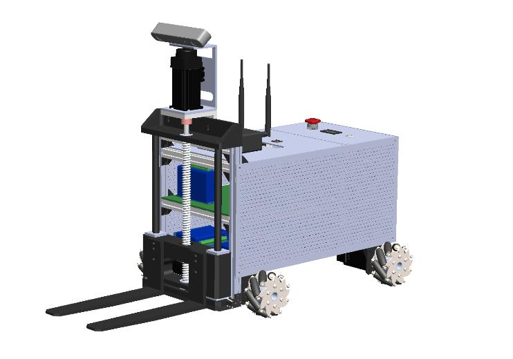
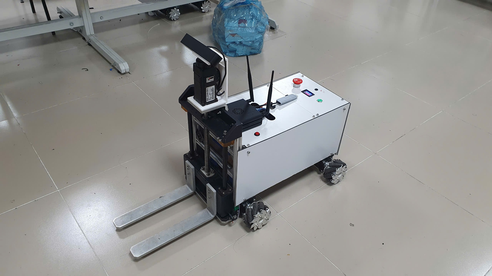
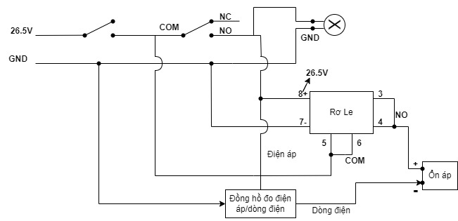

# 01. Hardware Architecture & Electrical Setup

This document details the mechanical design, compute platform, sensor suite, and power distribution architecture of the **Forklift AMR**.

---

## 1. Mechanical Design & Physical Implementation

The robot is designed as a compact, omnidirectional pallet-handling forklift built on an extruded aluminum chassis with four **Mecanum wheels** and a lead-screw vertical lifting mast.

| CAD 3D Design | Physical Prototype |
| :---: | :---: |
|  |  |

### Key Mechanical Specifications
* **Drive Configuration:** 4-wheel Mecanum omnidirectional drive (enables zero-radius rotation and lateral strafing in narrow warehouse aisles).
* **Lifting Mechanism:** Motorized lead-screw linear actuator with dual steel guide rails and aluminum forks.
* **Validated Static Payload:** **$19.34\text{ kg}$** static chassis load threshold without structural deflection or motor stall.
* **Safety Controls:** Top-mounted mushroom Emergency Stop (E-Stop) switch cutting main actuator power immediately upon actuation.

---

## 2. Compute & Sensor Suite (BOM)

| Component | Model / Specification | Role in System |
| :--- | :--- | :--- |
| **Main Compute** | NVIDIA Jetson Orin Nano | Runs ROS2 Humble, ZED SDK, SLAM Toolbox, AMCL, EKF, and Nav2 (`MAXN` power mode). |
| **Low-Level MCU** | ESP32 Development Board | Executes FreeRTOS real-time PID motor control, Mecanum kinematics, and Micro-ROS client over UART ($921600\text{ baud}$). |
| **3D Vision Sensor** | Stereolabs ZED2 Stereo Camera | Mounted atop the lifting mast; provides RGB-D point clouds (`/zed2/zed_node/point_cloud/cloud_registered`) for 3D obstacle avoidance (STVL) and pallet perception. |
| **2D LiDAR** | $360^\circ$ Planar Laser Scanner | Provides `/scan` topic for 2D SLAM mapping, AMCL localization, and planar obstacle detection. |
| **Inertial Sensor** | 6-Axis IMU | Publishes angular velocity and linear acceleration fused with wheel odometry via EKF. |
| **Actuation** | DC Geared Motors + Quadrature Encoders | Closed-loop velocity feedback for all four Mecanum wheels plus dedicated lift motor. |

---

## 3. Power Distribution & Protection Circuit

The system operates on a **$26.5\text{V}$ DC** main battery bus, isolated and regulated to protect sensitive compute electronics from motor back-EMF and voltage sags.



### Circuit Design Highlights
* **Main Isolation & E-Stop:** Power routes through a physical main switch and a Normally-Open / Normally-Closed (`NO`/`NC`) Emergency Stop contactor (`COM`), allowing immediate hardware-level power cut-off.
* **Relay Switching Logic:** A power relay isolates the high-current motor bus from the logic power rail, preventing inductive spikes during heavy load starts.
* **Voltage Regulation:** Dedicated DC-DC buck converters step down the $26.5\text{V}$ battery supply to clean, regulated rails for the Jetson Orin Nano, ZED2 camera, LiDAR, and ESP32.
* **Real-Time Telemetry:** An inline digital Voltmeter/Ammeter monitors battery state-of-charge and peak current draw under load.

---

## 4. Jetson Orin Nano Performance Optimization

To maintain deterministic $30\text{ Hz}$ local planning and real-time 3D point cloud voxelization without thermal throttling, the Jetson Orin Nano is locked to maximum performance mode:

```bash
# Set power mode to MAXN (Mode 0)
sudo nvpmodel -m 0

# Lock CPU/GPU/EMC clocks to maximum frequency
sudo jetson_clocks
```