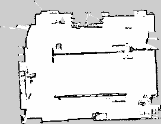
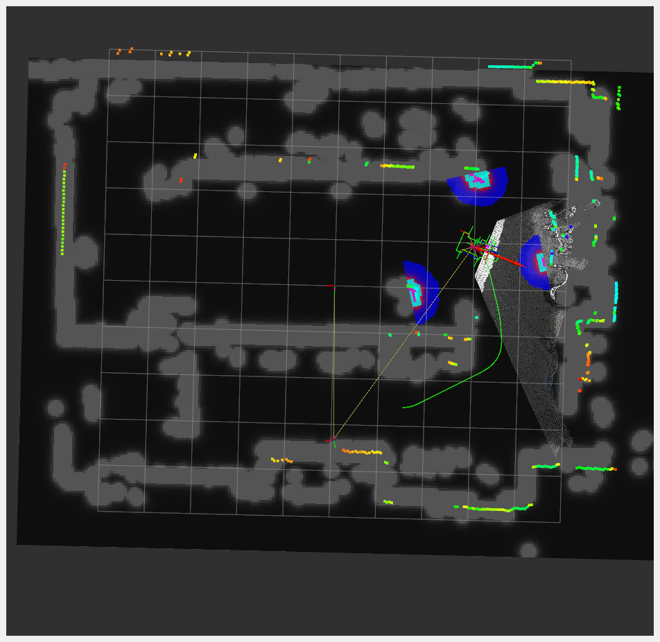

# 03. Autonomous Navigation & Nav2 Parameter Tuning

This document details the ROS2 Humble localization pipeline, 2D/3D multi-sensor costmap fusion, and engineering rationale behind the `nav2_params.yaml` configuration tailored for an omnidirectional forklift.

---

## 1. Localization & Sensor Fusion Pipeline

To prevent wheel-slip drift inherent to Mecanum rollers from degrading pose estimation, localization is structured in two stages:

1. **Continuous Odometry Fusion (`robot_localization` EKF):** Fuses host-computed forward Mecanum wheel odometry (derived from `/wheel_ticks`) with high-rate 6-axis IMU angular velocity and linear acceleration (`/imu_data`) to publish a smooth `/odometry/filtered` transform (`odom -> base_footprint`).
2. **Global Map Localization:**
   * **Mapping Mode:** Uses **SLAM Toolbox** (asynchronous online SLAM) to generate the 2D occupancy grid map of the warehouse environment.
   * **Navigation Mode:** Uses **AMCL** (Adaptive Monte Carlo Localization) matching `/scan` laser data against the static map (`map -> odom`).

<table align="center" width="100%" style="border-collapse: collapse; table-layout: fixed; margin: 20px 0;">
  <tr>
    <th align="center" width="50%" style="padding: 12px; font-size: 15px;">SLAM Generated Occupancy Map</th>
    <th align="center" width="50%" style="padding: 12px; font-size: 15px;">Live RViz2 Navigation</th>
  </tr>
  <tr>
    <td align="center" width="50%" style="padding: 0; vertical-align: middle; background-color: #ffffff;">
      
    </td>
    <td align="center" width="50%" style="padding: 0; vertical-align: middle; background-color: #1e1e1e;">
      
    </td>
  </tr>
</table>

---

## 2. Multi-Sensor 2D + 3D Costmap Architecture

A planar 2D LiDAR alone cannot detect elevated pallet racks, overhanging loads, or low-profile forks. Both the **Global Costmap** and **Local Costmap** fuse two distinct perception layers:

* **2D Planar Obstacle Layer:** Processes `/scan` laser returns for fast $360^\circ$ wall and perimeter tracking.
* **3D Spatio-Temporal Voxel Layer (`STVL`):** Integrates dense RGB-D point clouds from the mast-mounted ZED2 camera (`/zed2/zed_node/point_cloud/cloud_registered`), projecting 3D voxel obstacles onto the navigation plane with temporal decay to clear dynamic obstacles.
* **Inflation Layer:** Expands obstacle boundaries using an exponential cost decay curve tailored to the forklift's rectangular footprint.

---

## 3. Nav2 Tuning Rationale (`nav2_params.yaml`)

Every core parameter in the navigation stack was tuned to balance omnidirectional agility with heavy-payload safety ($19.34\text{ kg}$ max static load):

### Global Planner: `SmacPlannerHybrid`
* **Motion Model (`REEDS_SHEPP`):** Enables both forward and **reverse path generation**, essential for backing out of narrow pallet bays and aligning forks squarely with target stations.
* **Minimum Turning Radius & Reverse Penalty:** Tuned to exploit Mecanum maneuverability while penalizing unnecessary reversing over long transit corridors.

### Local Controller: `DWBLocalPlanner` ($30\text{ Hz}$)
* **Asymmetric Velocity Envelope:**
  * Longitudinal limit: $V_{x,\max} = 0.35\text{ m/s}$ (stable transit speed).
  * Lateral strafing limit: $V_{y,\max} = 0.20\text{ m/s}$ (restricted to prevent roller slip and lateral center-of-gravity shift).
* **Braking vs. Acceleration Asymmetry:** Deceleration limit (`decel_lim_x = -0.8 m/s²`) is set higher than acceleration (`acc_lim_x = 0.5 m/s²`) to guarantee crisp stopping distances before pallet contact while keeping starts smooth.
* **Lookahead Horizon (`sim_time = 2.5 s`):** Provides a long predictive trajectory horizon, naturally damping sharp path corners into smooth S-curves that protect unstrapped cargo.
* **Goal Convergence (`SimpleGoalChecker`):** Configured with a tight **$0.05\text{ m}$ ($5\text{ cm}$)** XY position tolerance for accurate pallet engagement.

### Trajectory Conditioning & Recovery
* **`velocity_smoother`:** Enforces kinematic acceleration/jerk bounds on `/cmd_vel` before publishing `/cmd_vel_smoothed` to the ESP32.
* **Behavior Tree Recovery:** Includes `Spin`, `BackUp`, and `Wait` recovery behaviors bounded by execution timeouts to safely halt the robot if persistent slip or sensor occlusion occurs.

---

[< Previous: 02. ESP32 Micro-ROS Firmware](02_firmware_esp32.md) | [Next: 04. Benchmarks & Field Tests >](04_benchmarks.md)