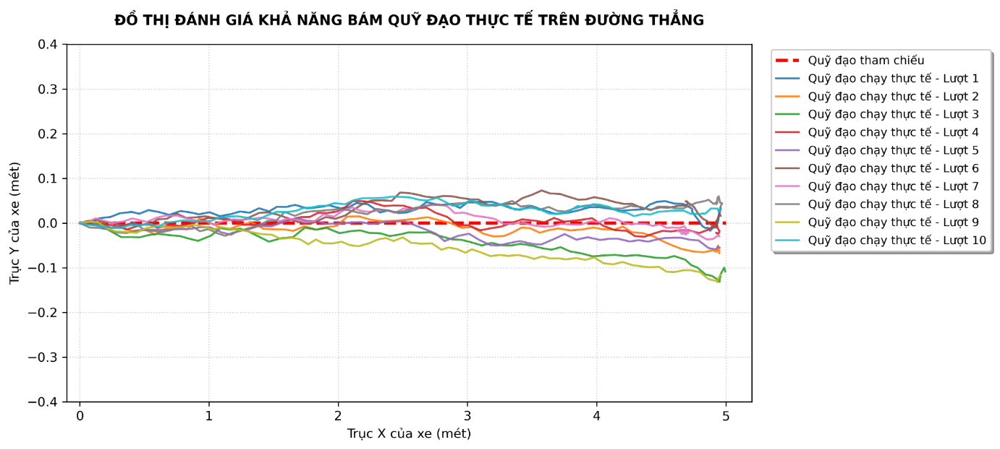
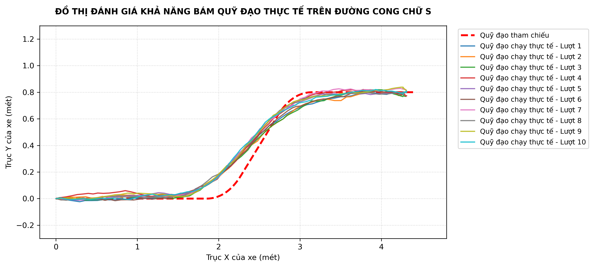

# 04. Empirical Benchmarks & Field Test Validation

To evaluate the robustness, stability, and repeatability of the autonomous navigation stack under real-world industrial conditions, the forklift underwent extensive empirical benchmarking instead of relying solely on software simulations.

---

## 1. Testing Methodology & Performance Metrics

All benchmarks were conducted on the physical robot loaded with a standard test pallet. Each scenario was executed for **$10$ consecutive trials** under identical warehouse conditions. Performance was measured using two primary metrics:
* **Goal Convergence Rate:** Percentage of successful trials reaching within the strict **$0.05\text{ m}$ ($5\text{ cm}$) XY goal tolerance** (`SimpleGoalChecker`).
* **Trajectory Tracking Error:** Maximum cross-track deviation ($Y$-axis slip) and longitudinal arrival time jitter.

| Straight Line Tracking ($10$ Overlaid Physical Runs) |
| :---: |
|  |

| S-Curve Trajectory Tracking ($10$ Overlaid Physical Runs) |
| :---: |
|  |

---

## 2. Quantitative Results & Scenario Analysis

### Scenario A: $5\text{m}$ Straight-Line Transit
* **Objective:** Test linear acceleration tuning, digital LPF smoothing, and straight-line odometry drift accumulation over a medium-range corridor.
* **Success Rate:** **$80\%$ ($8/10$ successful runs meeting the $5\text{ cm}$ threshold)**.
* **Failure Mode Analysis ($2/10$ runs):** In two trials, stochastic micro-slip on the Mecanum polyurethane rollers combined with minor IMU bias caused a lateral drift exceeding $5\text{ cm}$, triggering Nav2's path-recalculation behavior tree. However, the system recovered safely without stalling or cargo tipping.

### Scenario B: S-Curve Omnidirectional Maneuver
* **Objective:** Validate complex path-tracking performance, lateral strafing coordination, and velocity smoothing through continuous directional transitions.
* **Success Rate:** **$100\%$ ($10/10$ trials successfully completed)**.
* **Observations:** As visualized in the trajectory plot above, all 10 physical runs closely track the reference path (dashed red line) with minimal dispersion. The aggressive lookahead horizon (`sim_time = 2.5s`) and asymmetric deceleration limits effectively damp out high-frequency oscillations, protecting unstrapped cargo during sharp heading changes.

---

## 3. Summary Performance Matrix

| Benchmark Test | Target Metric | Measured Result | Status |
| :--- | :--- | :--- | :--- |
| **Static Payload Capacity** | $\ge 15\text{ kg}$ | **$19.34\text{ kg}$** without structural deflection | **Passed** |
| **Linear Path Convergence ($5\text{m}$)** | $\ge 90\%$ success | **$80\%$ ($8/10$ trials within $5\text{ cm}$)** | **Failed** |
| **S-Curve Path Repeatability** | $\ge 90\%$ success | **$100\%$ ($10/10$ trials completed)** | **Passed** |
| **Control Loop Determinism** | $50\text{ Hz}$ stable | **$50\text{ Hz}$** ($\pm 1\text{ ms}$ jitter via FreeRTOS) | **Passed** |
| **Navigation Update Rate** | $30\text{ Hz}$ local plan | **$30\text{ Hz}$** DWB Controller execution | **Passed** |

---

[< Previous: 03. Navigation & Nav2 Tuning](03_navigation_nav2.md)